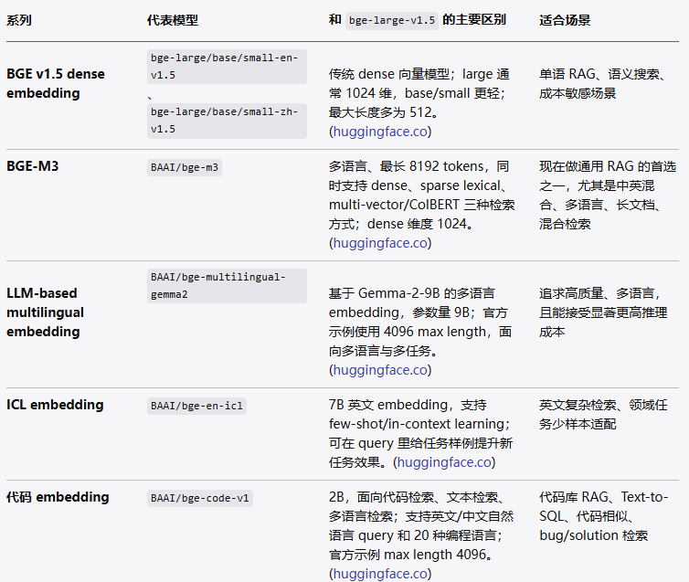
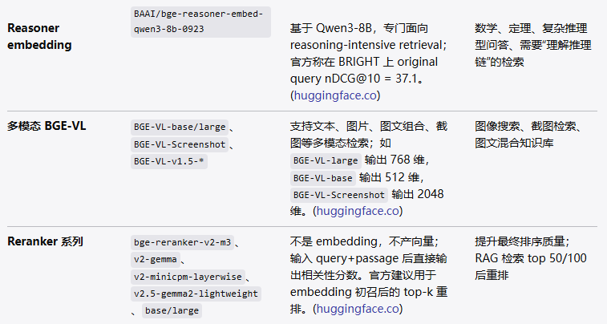
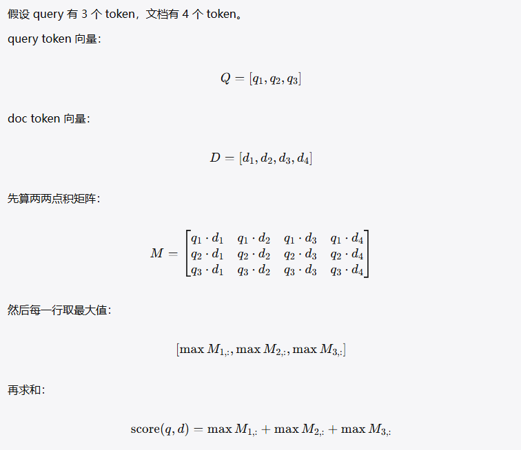

bge-m3

## 1、原理介绍

（1）bge的基本步骤包括哪些：

主要步骤包括切块、向量化、检索、生成。

（2）你当时做bge用的哪个模型，目前的bge模型有哪些。

我当时使用的是bge-v1.5-large-zh模型，专门为中文检索而适配的模型。

那么现在有哪些bge模型呢,具体如下：






## bge-m3

bge-m3不仅仅是传统的向量，而且还有sparse lexical、multi-vector等多个功能。

### dense

输入一句话，将其改为向量化编码，如1024维向量。

### sparse lexical

保留“关键词权重”的稀疏表示
Sparse lexical 可以理解成更聪明的关键词检索，类似 BM25，但由模型学习词的重要性。

它不是把一句话压成一个稠密向量，而是把文本表示成很多词的权重，例如：

```
{
  "苹果": 0.8,
  "手机": 0.6,
  "电池": 1.2,
  "发热": 1.5,
  "怎么办": 0.3
}
```

优点

- 对关键词、型号、术语、错误码、专有名词特别友好。
- 可解释性更强，因为你能看到哪些词贡献了匹配。
- 适合技术文档、API 文档、日志、代码、论文、产品手册。

缺点

- 语义泛化能力弱于 dense。
- 如果用户和文档用词完全不同，它可能找不到。
- 比如用户搜“手机很烫”，文档写“设备温度异常升高”，sparse 可能不如 dense。

Multi-vector

一个文本变成多个向量，做细粒度匹配

普通 dense 是：

text

```text
query -> 1 个向量
doc   -> 1 个向量
```

### multi-vector 

text

```text
query -> 多个向量
doc   -> 多个向量
```

比如 query：

> 苹果手机电池发热怎么办？

它可能给每个重要 token 或片段生成向量：

text

```text
苹果手机 -> 向量 A
电池     -> 向量 B
发热     -> 向量 C
怎么办   -> 向量 D
```

文档也会有很多向量：

text

```text
iPhone      -> 向量 1
battery     -> 向量 2
overheating -> 向量 3
solution    -> 向量 4
...
```

检索时不是简单比较“query 整体”和“doc 整体”，而是看 query 的每个局部是否都能在 doc 里找到对应内容。

这类方法常见代表是 ColBERT 风格的 late interaction。

优点

- 匹配更细，效果通常比单向量 dense 更好。
- 对长文档、多主题文档更友好。
- 能减少“整篇看起来相关，但关键点没覆盖”的情况。
- 适合高质量检索、rerank、复杂 query。

缺点

- 存储成本高，因为一个文档不止一个向量。
- 检索计算更贵。
- 工程复杂度高，不是所有向量数据库都原生支持。


新项目下，这些技术要怎么使用：

最简单只使用dense:

```
query -> dense vector -> 向量库检索 -> top-k 文档
```

更稳的方案

dense + sparse lexical

```
dense 负责语义召回
sparse 负责关键词召回
最后把分数融合
```

适合技术文档、产品文档、代码文档、知识库问答。

更高质量的方案：

```
dense + sparse lexical 做初召
multi-vector 或 reranker 做精排
```

**dense 看意思，sparse 看关键词，multi-vector 看局部细节。**
最常见的生产组合是：**dense + sparse 做召回，reranker 或 multi-vector 做精排**。


###  ColBERT 模式

 指 ColBERT（Contextualized Late Interaction over BERT） 式检索：不做"一句话一个向量"，而是保留每个 token 的向量。打分时查询 token 和文档 token 两两算相似度，每个查询 token
 取最大相似度再求和。所以它比 dense 更细粒度，能捕捉局部匹配。脚本里通过 return_colbert_vecs=True 拿到逐 token 向量，再用 compute_colbert_score 算分。

具体的操作如下：




### Hybrid查询

Hybrid 分数 = (1.0×dense分 + 0.3×sparse分 + 1.0×colbert分) / (1.0+0.3+1.0) 三种分数加权平均的结果。


## 2、结果查询

### dense 结果

```text
Q: 中兴通讯的5G技术怎么样？
  1. [d0] 0.7615  中兴通讯是全球领先的综合通信解决方案提供商，在5G基站、核心网和光传输领域拥有强大实力。
  2. [d30] 0.7495  中兴 5G 属于全球第一梯队，基站、核心网端到端能力成熟，Massive MIMO、节能、行业专网、
  3. [d1] 0.6126  5G网络相比4G具有更高的传输速率、更低的时延和更大的连接密度，可支持万物互联。

Q: 什么是机器学习？
  1. [d2] 0.7724  机器学习是人工智能的核心分支，通过数据训练模型来实现预测和分类任务。
  2. [d3] 0.5958  深度学习利用多层神经网络自动提取数据特征，在图像识别和语音识别领域取得突破。
  3. [d21] 0.5734  Machine learning algorithms learn patterns from da
```

从结果来看，dense的查询是最好的，几乎没有偏差。

### sparse 结果

```text
Q: 中兴通讯的5G技术怎么样？
  1. [d0] 0.1920  中兴通讯是全球领先的综合通信解决方案提供商，在5G基站、核心网和光传输领域拥有强大实力。
  2. [d30] 0.1262  中兴 5G 属于全球第一梯队，基站、核心网端到端能力成熟，Massive MIMO、节能、行业专网、
  3. [d17] 0.0484  数据加密技术通过算法将明文转换为密文，保障信息传输和存储的机密性。

Q: 什么是机器学习？
  1. [d2] 0.2195  机器学习是人工智能的核心分支，通过数据训练模型来实现预测和分类任务。
  2. [d3] 0.1234  深度学习利用多层神经网络自动提取数据特征，在图像识别和语音识别领域取得突破。
  3. [d4] 0.0538  自然语言处理（NLP）研究计算机与人类语言之间的交互，包括机器翻译、问答系统和情感分析。
```

sparse的结果中 q1的查询d17和q2的查询d4的结果都不佳。

### hybrid 结果

```text
Q: 中兴通讯的5G技术怎么样？
  1. [d0] 0.7204  中兴通讯是全球领先的综合通信解决方案提供商，在5G基站、核心网和光传输领域拥有强大实力。
  2. [d30] 0.6917  中兴 5G 属于全球第一梯队，基站、核心网端到端能力成熟，Massive MIMO、节能、行业专网、
  3. [d1] 0.5579  5G网络相比4G具有更高的传输速率、更低的时延和更大的连接密度，可支持万物互联。

Q: 什么是机器学习？
  1. [d2] 0.7942  机器学习是人工智能的核心分支，通过数据训练模型来实现预测和分类任务。
  2. [d3] 0.6181  深度学习利用多层神经网络自动提取数据特征，在图像识别和语音识别领域取得突破。
  3. [d21] 0.5581  Machine learning algorithms learn patterns from da
```

hybrid的查询结果明显比sparse的结果要好，基本和dense 结果相当。

### colbert 结果

```text
Q: 中兴通讯的5G技术怎么样？
  1. [d0] 0.8379  中兴通讯是全球领先的综合通信解决方案提供商，在5G基站、核心网和光传输领域拥有强大实力。
  2. [d30] 0.8034  中兴 5G 属于全球第一梯队，基站、核心网端到端能力成熟，Massive MIMO、节能、行业专网、
  3. [d1] 0.6563  5G网络相比4G具有更高的传输速率、更低的时延和更大的连接密度，可支持万物互联。

Q: 什么是机器学习？
  1. [d2] 0.9884  机器学习是人工智能的核心分支，通过数据训练模型来实现预测和分类任务。
  2. [d3] 0.7889  深度学习利用多层神经网络自动提取数据特征，在图像识别和语音识别领域取得突破。
  3. [d21] 0.7103  Machine learning algorithms learn patterns from da
```

colbert的结果也比较好和dense结果一致。事实证明向量查询基本和colbert、hybrid的结果一致。sparse 查询效果稍微差一点。


这里分析下原因吧，为什么sparse 的结果差呢：

```
查询 [q0] '中兴通讯的5G技术怎么样？' 的 top-12 词权重:
  '兴'                   weight=0.229
  '技术'                  weight=0.192
  '5'                   weight=0.189
  'G'                   weight=0.179
  '通讯'                  weight=0.146
  '怎么样'                 weight=0.139
  '中'                   weight=0.056
  '?'                   weight=0.044
  '的'                   weight=0.013
  
=== 查询 [q0] '中兴通讯的5G技术怎么样？' 对各文档打分 ===

[d0] 中兴通讯是全球领先的综合通信解决方案提供商，在5G基站、核心网和光传输领域拥有强大实力。...
sparse=0.192   dense=0.762
共同token贡献: '兴'(0.23x0.36=0.083)  '通讯'(0.15x0.29=0.042)  '5'(0.19x0.16=0.030)  'G'(0.18x0.14=0.026)  '中'(0.06x0.18=0.010)  '的'(0.01x0.06=0.001)

[d20] ZTE Corporation is a leading global provider of ...
sparse=0.034   dense=0.524
共同token贡献: 'G'(0.18x0.19=0.034)

[d30] 中兴 5G 属于全球第一梯队，基站、核心网端到端能力成熟，Massive MIMO、节能、行业专...
sparse=0.126   dense=0.750
共同token贡献: '兴'(0.23x0.31=0.070)  'G'(0.18x0.27=0.048)  '中'(0.06x0.15=0.008)

[d31] 中兴  zte chisi...
sparse=0.045   dense=0.569
共同token贡献: '兴'(0.23x0.19=0.044)  '中'(0.06x0.03=0.001)
```

至于为什么中兴通讯的5G技术怎么样会查询到，原因是“技术”和“的”的权重太高了，会导致整体的检索效果很差。

链路是这样的：

    1. 查询里"技术"权重 0.19（"5G技术"是查询的重点词之一，模型学出来的权重不低）
    2. d17 里"技术"权重高达 0.25（"数据加密技术"同样是 d17 的重点词）
    3. sparse 打分是共同 token 权重乘积求和，两边都是高权词 → 光这一项就 0.047
    4. 而真正相关的 d20（英文）只能靠一个 "G" 匹配 0.034——所以 d17 在 sparse 里反而排到 d20 前面


## 3、相关问题

### 1、bge-m3和普通的bge有什么不同

bge-m3共有三种词语或者句子的表现方式，分别是dense、sparse lexical、multi vector三种形式，相比于普通的向量检索模型，sparse lexical和multi vector是另外两种，分别是关键词权重匹配和，关键词向量匹配，一个是给句子中不同的词语给与相应的权重，另一个是给句子中不同的词语给与不同的词向量。分别进行匹配和检索


### 2、multi vector中的词向量是怎么来的

bge-m3的主要训练原理还是robert-transformer模型的改版，所以基本还是遵循bert的向量编码原理，输入句子，对句子进行分词，对每个分词的结果得到对应的词向量。其实还是一个embedding的结果


### 3、multi vector中的词向量在不同的句子中，向量的格式一样吗

格式不一样，不同的词在不同的句子中是不同的向量表示，原因如下，bge-m3整体来看仍然是一个transformer模型，那么在计算每个词语的词向量时必然会进行transformer的self-attention操作,也就是说一个词语会和整个句子的其他词语做一个向量与权重的融合计算，而每个句子的词语不同，同一个词语得到的词向量也不同。


### 4、从你检索的结果来看，为什么sparse的结果。

从结果来看，为什么sparse的检索效果不好，因为sparse是通过字和字的相似度比对进行检索的，如果两个句子中一样的字很多，且权重较大的话，那么很可能在空间层面被认定为相似。比如高兴和中兴两个兴，在一定程度上就会进行相似度的计算。所以句子中的相似字或者词很多的时候有可能就会被认为两者相似。


### 5、bge的相似度检索和reranker之间有什么区别

检索和reranker都是搜索，但是检索是粗排，相当于在几百万的文档中找出跟用户输入的query相关的句子，reranker是精排，相当于在检索的基础找出跟问题更相关的topk。

那么两者的区别在哪呢：

1、检索是分别向量化，即输入q和文档d，

在 BGE 体系里，常见做法是用 bge-large-zh、bge-m3 这类 embedding 模型：

（1）把用户问题编码成一个向量
（2）把知识库里的每段文本也编码成向量
（3）用余弦相似度 / 内积等方法找最接近的文本

主要特点是：

（1）**速度快**

（2）**适合大规模检索**

（3）文档向量可以**提前离线计算**

（4）可以配合 FAISS、Milvus、ES 等向量库

缺点：query和document交互不充分，大致相关不一定完全符合query的意图

（2）一般来说检索的排序精度不如reranker


2、reranker

精排，主要的作用是对检索后的内容进一步的排序。具体的做法为：

BGE 的 reranker 一般是 **cross-encoder** 思路，例如把：

- query：`bge的相似度检索和reranker区别`
- passage：`BGE reranker 用于对召回结果进行重排序...`

一起输入模型，让模型直接输出一个相关性分数。

特点：

**query 和文档一起看**

能做更细粒度的相关性判断

常用于对 top-k 候选结果重排

缺点：reranker比较慢，不能对所有的文档都进行一次reranker,reranker是联合建模，设问题为q，待排序文档为d,则reranker的做法为score(q,d)得到相关性的分数。

所以，reranker一般是放在检索后面使用的，**embedding 检索负责从 100 万条里找出 100 条**

**reranker 负责从这 100 条里找出最好的 5 条**。


相关的问题：

1、假如做RAG检索整体的效果太差，有什么好的解决办法吗？

1. **文档处理有问题**（切分、清洗、结构化差）
2. **向量召回有问题**（embedding 不匹配、topk 不合理）
3. **召回策略太单一**（只靠向量检索）
4. **排序不准**（召回到了，但排前面的不是最优）
5. **查询理解不足**（用户问题没被改写、扩展）
6. **知识库本身质量差**（内容过时、重复、噪声多）

所以具体的需要具体分析：

1）抽取一些回答样本人工审查。

- **情况 A：正确文档根本没进 topK**
  - 说明是 **召回问题**
  - 重点看：切块、embedding、混合检索、query 改写
- **情况 B：正确文档进了 topK，但排序靠后**
  - 说明是 **重排问题**
  - 重点看：reranker、排序特征、topK 设置
- **情况 C：检索结果其实对，但 LLM 回答不好**
  - 说明不完全是检索问题
  - 重点看：prompt、上下文拼接、引用方式、模型能力

### 1、文档切块的问题

很多 RAG 效果差，根本原因就是 chunk 切得不对。

常见问题
切得太大：一个 chunk 里主题太多，向量语义不纯
切得太小：上下文不完整，检索到也答不出来
生硬按字数切：把一个完整段落、表格、步骤拆散了
没保留标题层级：检索结果失去结构语义

改进建议：

（1）对于每个技术文档，先按照标题、小节、段落、列表、表格进行切分。

（2）每个切分的chunk保留对应的1级标题、2级标题、本段正文等等。召回时可以附带上这些信息。

（3）在benchmark的测试集中调整overlap的比例。

（4）文档分类，不要将所有的文档都放在一个检索库中，最好能根据内容进行相应的分类，query检索时使用端侧的分类模型先分类再在特定的检索库中进行检索。

### 2、优化embedding模型

（1）首先看你的数据是非中文还是中文，不同的数据需要不同的embedding模型。

（2）对embedding模型做增量微调，在原有embedding的基础对模型进行特定数据的增量微调。确保检索模型在特定领域的检索效果

（3）看看topk、相似度检索的指标是否合适。

（4）建议加入混合检索，使用关键词和embedding双重检索。 


### 3、多路检索优化

（1）query改写，用户的问题往往写得很随意，而文档写得很正式。
这会导致 query 和 document 表述不一致。

把用户问题改写成更适合检索的形式。

例如： 用户问：

> 这个接口报 401 怎么办？

改写后：

> API 接口返回 401 Unauthorized 的原因、排查步骤和解决方案

这样检索通常更稳。

（2）检索增强

增加知识图谱、同义词词库等多种手段。

- “登录失败” -> “认证失败 / 鉴权失败 / sign in failed”
- “额度” -> “限额 / credit line / quota”

特别适合：

- 企业内部黑话
- 多语言混杂
- 同义表达很多的场景

（3）多路查询

把一个复杂问题拆成多个子查询分别检索。

例如：

> 某产品 A 在海外环境部署时，登录失败且数据库连接超时，怎么排查？

可以拆成：

- 产品 A 海外环境部署要求
- 登录失败排查
- 数据库连接超时排查

再汇总结果。

（4）给检索加过滤条件。增加检索的可能性。这也代表数据在入库时也需要添加相应的关键词

请假流程怎么走？

- 地区 = 上海
- 员工类型 = 正式员工
- 文档状态 = 当前有效

也就是说检索时看是否需要添加关键词，如果需要则让人补充。

（5）父子块检索

做法：

- 小块用于检索，提高精度
- 大块或父文档用于提供上下文，提高可读性

也就是：

- 索引时切小块
- 命中后返回对应的大段或整节内容

（6）特殊化处理：对于表格或者一些结构化、非结构化内容最好做个特殊化处理。

如表格转为markdwon文档

图片转为ocr文本，并给出对应的结构化信息。

```json
{
  "image_type": "UI screenshot",
  "page_title": "单点登录配置",
  "ocr_text": "启用 SAML 保存配置 身份提供商",
  "image_summary": "该截图展示了后台管理页面中单点登录配置区域，包含启用 SAML 开关和身份提供商设置项。"
}
```


