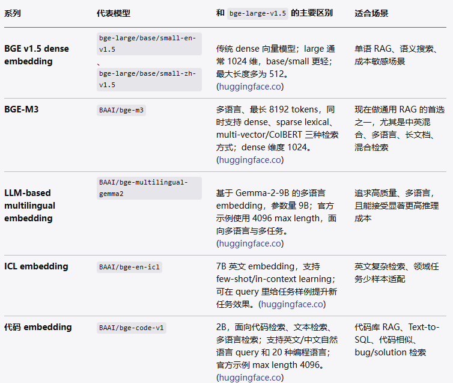
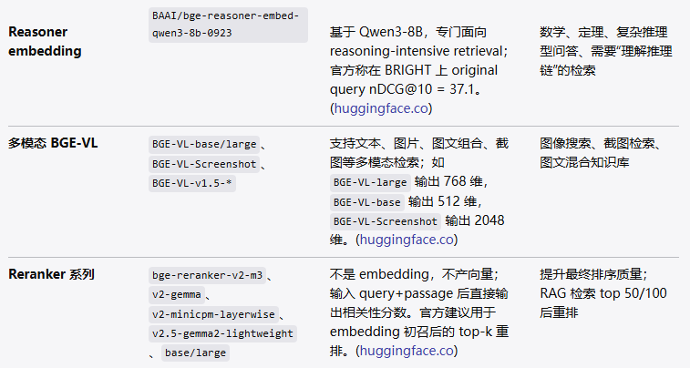
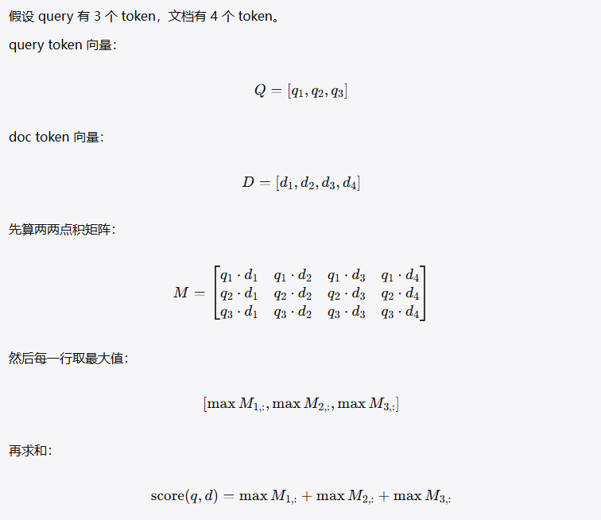

bge-m3

## 1、原理介绍

（1）bge的基本步骤包括哪些：

主要步骤包括切块、向量化、检索、生成。

（2）你当时做bge用的哪个模型，目前的bge模型有哪些。

我当时使用的是bge-v1.5-large-zh模型，专门为中文检索而适配的模型。

那么现在有哪些bge模型呢,具体如下：






## bge-m3

bge-m3不仅仅是传统的向量，而且还有sparse lexical、multi-vector等多个功能。

### dense

输入一句话，将其改为向量化编码，如1024维向量。

### sparse lexical

保留“关键词权重”的稀疏表示
Sparse lexical 可以理解成更聪明的关键词检索，类似 BM25，但由模型学习词的重要性。

它不是把一句话压成一个稠密向量，而是把文本表示成很多词的权重，例如：

```
{
  "苹果": 0.8,
  "手机": 0.6,
  "电池": 1.2,
  "发热": 1.5,
  "怎么办": 0.3
}
```

优点

- 对关键词、型号、术语、错误码、专有名词特别友好。
- 可解释性更强，因为你能看到哪些词贡献了匹配。
- 适合技术文档、API 文档、日志、代码、论文、产品手册。

缺点

- 语义泛化能力弱于 dense。
- 如果用户和文档用词完全不同，它可能找不到。
- 比如用户搜“手机很烫”，文档写“设备温度异常升高”，sparse 可能不如 dense。

Multi-vector

一个文本变成多个向量，做细粒度匹配

普通 dense 是：

text

```text
query -> 1 个向量
doc   -> 1 个向量
```

### multi-vector 

text

```text
query -> 多个向量
doc   -> 多个向量
```

比如 query：

> 苹果手机电池发热怎么办？

它可能给每个重要 token 或片段生成向量：

text

```text
苹果手机 -> 向量 A
电池     -> 向量 B
发热     -> 向量 C
怎么办   -> 向量 D
```

文档也会有很多向量：

text

```text
iPhone      -> 向量 1
battery     -> 向量 2
overheating -> 向量 3
solution    -> 向量 4
...
```

检索时不是简单比较“query 整体”和“doc 整体”，而是看 query 的每个局部是否都能在 doc 里找到对应内容。

这类方法常见代表是 ColBERT 风格的 late interaction。

优点

- 匹配更细，效果通常比单向量 dense 更好。
- 对长文档、多主题文档更友好。
- 能减少“整篇看起来相关，但关键点没覆盖”的情况。
- 适合高质量检索、rerank、复杂 query。

缺点

- 存储成本高，因为一个文档不止一个向量。
- 检索计算更贵。
- 工程复杂度高，不是所有向量数据库都原生支持。


新项目下，这些技术要怎么使用：

最简单只使用dense:

```
query -> dense vector -> 向量库检索 -> top-k 文档
```

更稳的方案

dense + sparse lexical

```
dense 负责语义召回
sparse 负责关键词召回
最后把分数融合
```

适合技术文档、产品文档、代码文档、知识库问答。

更高质量的方案：

```
dense + sparse lexical 做初召
multi-vector 或 reranker 做精排
```

**dense 看意思，sparse 看关键词，multi-vector 看局部细节。**
最常见的生产组合是：**dense + sparse 做召回，reranker 或 multi-vector 做精排**。


###  ColBERT 模式

 指 ColBERT（Contextualized Late Interaction over BERT） 式检索：不做"一句话一个向量"，而是保留每个 token 的向量。打分时查询 token 和文档 token 两两算相似度，每个查询 token
 取最大相似度再求和。所以它比 dense 更细粒度，能捕捉局部匹配。脚本里通过 return_colbert_vecs=True 拿到逐 token 向量，再用 compute_colbert_score 算分。

具体的操作如下：




### Hybrid查询

Hybrid 分数 = (1.0×dense分 + 0.3×sparse分 + 1.0×colbert分) / (1.0+0.3+1.0) 三种分数加权平均的结果。


## 2、结果查询

### dense 结果

```text
Q: 中兴通讯的5G技术怎么样？
  1. [d0] 0.7615  中兴通讯是全球领先的综合通信解决方案提供商，在5G基站、核心网和光传输领域拥有强大实力。
  2. [d30] 0.7495  中兴 5G 属于全球第一梯队，基站、核心网端到端能力成熟，Massive MIMO、节能、行业专网、
  3. [d1] 0.6126  5G网络相比4G具有更高的传输速率、更低的时延和更大的连接密度，可支持万物互联。

Q: 什么是机器学习？
  1. [d2] 0.7724  机器学习是人工智能的核心分支，通过数据训练模型来实现预测和分类任务。
  2. [d3] 0.5958  深度学习利用多层神经网络自动提取数据特征，在图像识别和语音识别领域取得突破。
  3. [d21] 0.5734  Machine learning algorithms learn patterns from da
```

从结果来看，dense的查询是最好的，几乎没有偏差。

### sparse 结果

```text
Q: 中兴通讯的5G技术怎么样？
  1. [d0] 0.1920  中兴通讯是全球领先的综合通信解决方案提供商，在5G基站、核心网和光传输领域拥有强大实力。
  2. [d30] 0.1262  中兴 5G 属于全球第一梯队，基站、核心网端到端能力成熟，Massive MIMO、节能、行业专网、
  3. [d17] 0.0484  数据加密技术通过算法将明文转换为密文，保障信息传输和存储的机密性。

Q: 什么是机器学习？
  1. [d2] 0.2195  机器学习是人工智能的核心分支，通过数据训练模型来实现预测和分类任务。
  2. [d3] 0.1234  深度学习利用多层神经网络自动提取数据特征，在图像识别和语音识别领域取得突破。
  3. [d4] 0.0538  自然语言处理（NLP）研究计算机与人类语言之间的交互，包括机器翻译、问答系统和情感分析。
```

sparse的结果中 q1的查询d17和q2的查询d4的结果都不佳。

### hybrid 结果

```text
Q: 中兴通讯的5G技术怎么样？
  1. [d0] 0.7204  中兴通讯是全球领先的综合通信解决方案提供商，在5G基站、核心网和光传输领域拥有强大实力。
  2. [d30] 0.6917  中兴 5G 属于全球第一梯队，基站、核心网端到端能力成熟，Massive MIMO、节能、行业专网、
  3. [d1] 0.5579  5G网络相比4G具有更高的传输速率、更低的时延和更大的连接密度，可支持万物互联。

Q: 什么是机器学习？
  1. [d2] 0.7942  机器学习是人工智能的核心分支，通过数据训练模型来实现预测和分类任务。
  2. [d3] 0.6181  深度学习利用多层神经网络自动提取数据特征，在图像识别和语音识别领域取得突破。
  3. [d21] 0.5581  Machine learning algorithms learn patterns from da
```

hybrid的查询结果明显比sparse的结果要好，基本和dense 结果相当。

### colbert 结果

```text
Q: 中兴通讯的5G技术怎么样？
  1. [d0] 0.8379  中兴通讯是全球领先的综合通信解决方案提供商，在5G基站、核心网和光传输领域拥有强大实力。
  2. [d30] 0.8034  中兴 5G 属于全球第一梯队，基站、核心网端到端能力成熟，Massive MIMO、节能、行业专网、
  3. [d1] 0.6563  5G网络相比4G具有更高的传输速率、更低的时延和更大的连接密度，可支持万物互联。

Q: 什么是机器学习？
  1. [d2] 0.9884  机器学习是人工智能的核心分支，通过数据训练模型来实现预测和分类任务。
  2. [d3] 0.7889  深度学习利用多层神经网络自动提取数据特征，在图像识别和语音识别领域取得突破。
  3. [d21] 0.7103  Machine learning algorithms learn patterns from da
```

colbert的结果也比较好和dense结果一致。事实证明向量查询基本和colbert、hybrid的结果一致。sparse 查询效果稍微差一点。


这里分析下原因吧，为什么sparse 的结果差呢：

```
查询 [q0] '中兴通讯的5G技术怎么样？' 的 top-12 词权重:
  '兴'                   weight=0.229
  '技术'                  weight=0.192
  '5'                   weight=0.189
  'G'                   weight=0.179
  '通讯'                  weight=0.146
  '怎么样'                 weight=0.139
  '中'                   weight=0.056
  '?'                   weight=0.044
  '的'                   weight=0.013
  
=== 查询 [q0] '中兴通讯的5G技术怎么样？' 对各文档打分 ===

[d0] 中兴通讯是全球领先的综合通信解决方案提供商，在5G基站、核心网和光传输领域拥有强大实力。...
sparse=0.192   dense=0.762
共同token贡献: '兴'(0.23x0.36=0.083)  '通讯'(0.15x0.29=0.042)  '5'(0.19x0.16=0.030)  'G'(0.18x0.14=0.026)  '中'(0.06x0.18=0.010)  '的'(0.01x0.06=0.001)

[d20] ZTE Corporation is a leading global provider of ...
sparse=0.034   dense=0.524
共同token贡献: 'G'(0.18x0.19=0.034)

[d30] 中兴 5G 属于全球第一梯队，基站、核心网端到端能力成熟，Massive MIMO、节能、行业专...
sparse=0.126   dense=0.750
共同token贡献: '兴'(0.23x0.31=0.070)  'G'(0.18x0.27=0.048)  '中'(0.06x0.15=0.008)

[d31] 中兴  zte chisi...
sparse=0.045   dense=0.569
共同token贡献: '兴'(0.23x0.19=0.044)  '中'(0.06x0.03=0.001)
```

至于为什么中兴通讯的5G技术怎么样会查询到，原因是“技术”和“的”的权重太高了，会导致整体的检索效果很差。

链路是这样的：

    1. 查询里"技术"权重 0.19（"5G技术"是查询的重点词之一，模型学出来的权重不低）
    2. d17 里"技术"权重高达 0.25（"数据加密技术"同样是 d17 的重点词）
    3. sparse 打分是共同 token 权重乘积求和，两边都是高权词 → 光这一项就 0.047
    4. 而真正相关的 d20（英文）只能靠一个 "G" 匹配 0.034——所以 d17 在 sparse 里反而排到 d20 前面