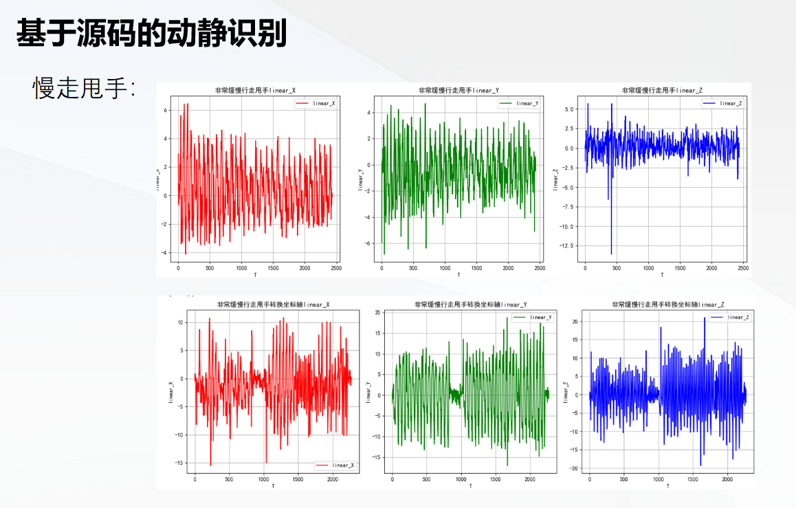
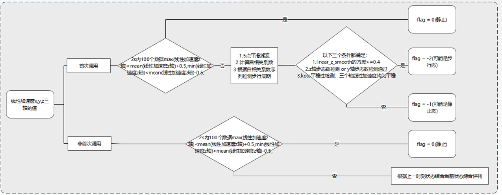
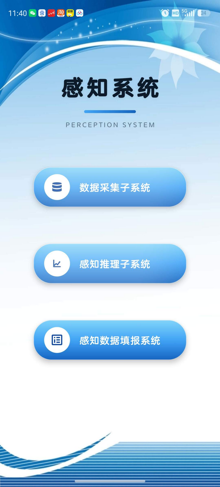
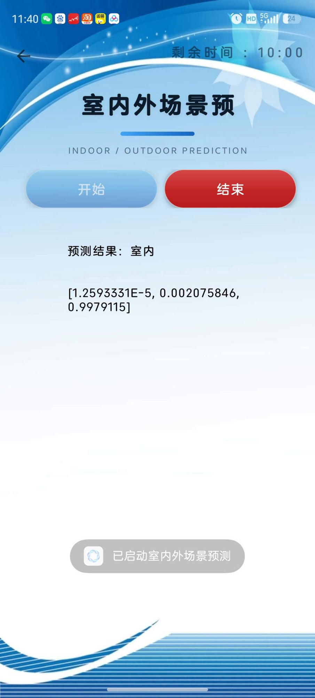
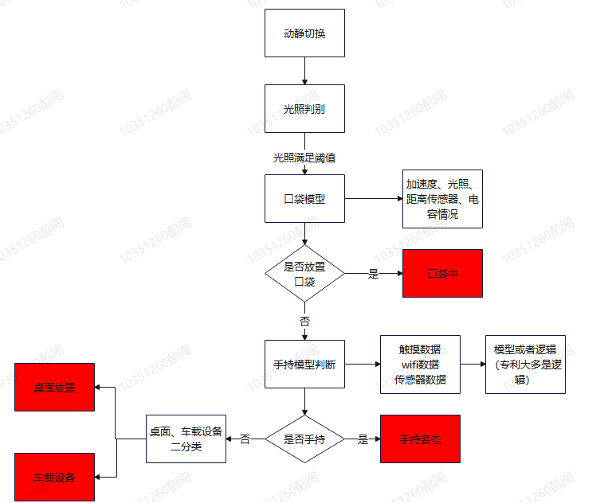
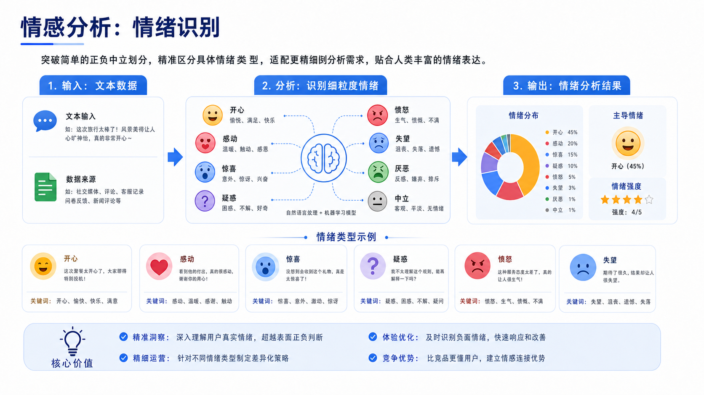
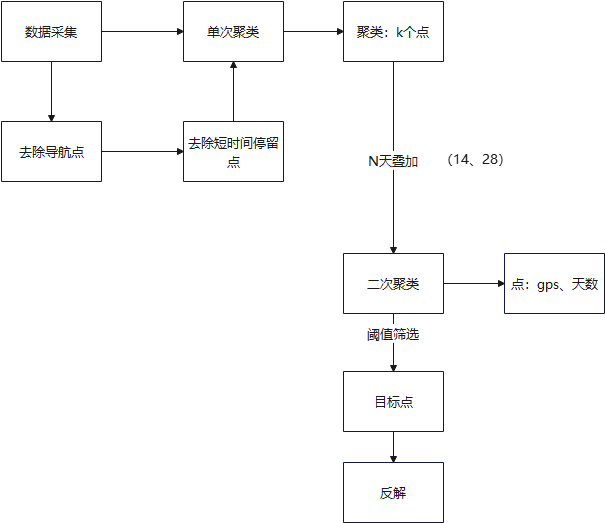
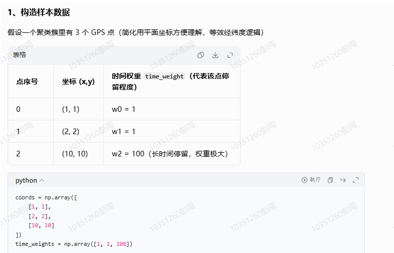
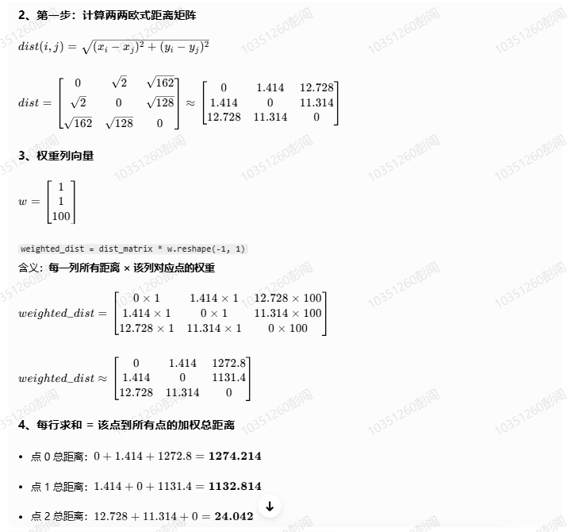

项目综述：

2024年8月-11月


# 项目1：云端大模型log分析部署

部门研发提效任务，需要研发一个log分析系统，帮助用户进行手机log的分析、关键词提取、有效问答等项目，帮助用户解决log相关分析等项目，具体为：

（1）用户输入一个log的日志和故障的相关描述，根据用户的日志和相关的描述定位相关的log。找出故障log的关键词，并输出相应的log，支持log的窗口二次问答，用户通过问答的方式，能够二次对log进行相关的定位和解答。

（2）系统分析：批量对log进行相关的分析，将log的分析分为，意图识别、文件夹意图提取、数据预处理、数据定位，上下文分析、大模型分析，结论得出，每一步都设置了相应的前端页面代码，将其规整化输出，并设置了相关的进度条，保证数据的后台稳定输出。


具体的做法为：

（1）用户输入对应的log文件。

（2）采用关键词词库进行区分分析。根据故障类型，故障大概分为：

wifi连接问题、异常断开问题、网络问题、连接问题、 死机5类，5类先使用关键词进行初筛，将其划分到对应的故障领域。 这边数据集大概300来看，分布不均衡，每个类别80-100多不等。

（3）数据清洗和入库，用户上传的是个对应的log压缩包，这边需要先对log进行解压，解压后根据对应的log分类寻找对应的文件夹，比如 

第一步：文件夹定位： logcat:为系统应用、系统服务等相关类型的日志。对应上面的wiif连接、异常断开、网络问题、连接问题等，kernel内核则对应的相应的死机问题。Modem**射频 / 基带日志**：手机通信模块，通话、SIM、4G/5G、信号、VoLTE等日志作为连接问题的辅助。

日志合并：采用合并脚本将多个log文件合并为1个进行统一分析。

第二步：log定位，使用故障描述的时间，找出日志中对应的日志节点。其次使用专人使用的关键词进行相关日志的节点，使用公司已经训练好的星云大模型进行日志的理解和解析，得到模型的分析结果。

第三步：关键词定位，由我司的专门的日志解析人员，通过关键词匹配算法，匹配上下文的关键词，当然页面也支持相关关键词的添加按钮。用户除了本身的关键词传输以外还支持人工的关键词输入。

第四步：rag功能，除了上述可以直接分析log以外，我们还对log进行了相关的清洗，由专门的人员将log和对应的问题分析组成了数据集，分析的主要片段包括：1、关键日志、错误原因、log原文，将得到的片段使用向量数据库存储在es上，采用fassi+向量检索的方式作为一个专门的知识数据，然后这里采用


难点：

（1）如何选择模型让其能够快速的理解手机的日志。这边对比了很多模型，包括qwen-72b模型，公司的星云模型 72b和128k超长，这里单纯使用日志的问题解析的选择题的方式，分别检测了模型的性能。最终从公司的6个模型中选择了两个，一个是上下文能力最长的模型，一个是模型理解能力最好的模型。在初步混合分析的时候采用对log理解能力最好的模型去进行判断和回答，问答长度超过一定范围的时候则采用128k的模型进行混合问答，确保模型对长问答的理解能力。

（2）加入了rag的检索能力，这里采用了最新的bge模型对输入的文本进行了embedding,拼接的方式主要为问题+答案,当时使用的仍然是bge的全家桶，bge+bge reranker,bge进行检索，bge reranker进行重排，将重排后的结果返回给大模型进行进一步的回答。

难点：（1）这样做的好处是不需要预调整大模型，只需要通过检索增强的方式便可以很轻松得到对应参考答案，防止模型走偏。但难点是不同的故障对应的问题是不一样的，检索的内容反而会污染大模型的思考。

但是实际的测试过程中遇到了很多检索不准确，大模型的回答容易受到干扰的问题：

归结起来的原因如下：
（1）检索的领域过大：5类故障（wifi/断开/网络/连接/死机）共用一个向量库，这样检索产生错乱，如wifi问题检索到死机问题，会产生天然的跑偏。

（2）更新了检索的输入和匹配的输入，log日志检索，一开始使用的问题是 故障日志和用户描述，这样检索的长度较长，且用户描述不是标准的描述，如 用户输入的是手机老断网+log日志，这里我是对用户的描述进行规整化处理，如

手机老是断网（口语化严重），这里采用大模型让其变成技术性话语，然后采用关键词匹配的策略，给出命中的关键词，让大模型生成几条关键的技术性假设，使用规整的技术话语+关键词命中得到的技术假设进行多路并排检索，得到相应的检索片段

（3）reranker置信度判断：多路检索后对结果进行重排，使用reranker对检索到的结果按照对应的置信度阈值进行筛选和重排，第二，采用prompt限制，在重排以后对输入给大模型时，在其中给出明确提示，让大模型自己选择跟当前故障或者问题相关的片段。无关的不要纳入模型进行相关的思考。

（4）chunk切分，检索库中的日志切分主要采用专人切分，入库时对日志中的无关数据进行了清理，主要包含日志前 时间 应用 等系统提示的数据。尽可能确保数据规整且长度不超过embedding的长度。


# 项目2：音乐生成

## 1、项目背景和难点

### 1.1 项目背景

公司想发布一个音乐手机，通过用户哼唱一部分的歌曲，利用端侧模型给用户续上一段音乐，在原有的哼唱背景下通过模型生成得到一部分的续写音频。然后合并成一个完整的音频提供给用户用做手机铃声。

### 1.2 难点

这个项目的主要难点在，输入为一个人的哼唱，输出为一个歌曲（midi音乐），如何让模型理解这个人的哼唱旋律，其次，如何让旋律整体能更好听一点。

所以，这里设计的整体的项目步骤为。

输入人声->人声转midi->midi音乐节奏增强->mkvw音乐生成模型->生成时间限制（生成5s、10s、15s、30s、60s）->呈现给用户。


### 1.3 难点与解决

1、调研：目前这个当时的想法就是选择一个开源模型，通过对开源模型进行加工和处理，从而得到对应的midi音乐，但是当时从人声转为midi以后会发现，整体的midi旋律音色单调、旋律不足， 这样喂入的模型的数据较差。输出的结果就较差。2、其次，当时选择的基准开源模型为rwkv，因为当时对比网络上的多个开源的midi模型，这个是纯rnn生成，即属于输入midi，生成midi。其次，这个当时在各个网站上的评分较好。 选择后要做的就是对这个模型进行量化和测试，量化的主要步骤就是将其转为onnx,当时采用的torch转onnx,转换完成后我们下载了几个经典的midi音乐进行截断，使用模型进行生成，发现模型存在重复出音的情况，比如生成到后面音色突然拉长，或者陷入死循环的清理。3、最后, rwkv整体的框架为rnn框架，所以在生成5s-15s的音乐的时候就还好，但是当生成的数据很多的时候,生成的时间较慢，需要1分钟到1分半，所以这边优化生成的速度。


#### 1、数据问题：midi音乐

midi音乐当时的做法主要分为两个方向：

（1）自己搜集数据集，通过淘宝购买，线上数据爬取获取大量的丰富的midi音乐。

（2）爬取，对相关的免费的midi网站进行midi音乐的爬取。 通过这两个手段大致获取了60w首左右的midi音乐集。

#### 2、人声转换为midi

人声转midi，其实就是分解人的声音转换问题，一开始采用的basic-pitch模型,这个是个cnn模型，具体的是以cnn模型为基础，通过梅尔特征提取，将其转换为pitch激活码和onset、offset的形式。但是做出来会有几个不好的地方，1、人声中一些气声（说话人的哈气）等声音会导致噪声midi的出现。2是转换midi旋律不连贯问题，人声发声时由于是人声说话或者说唱的问题，天然不可能整体的音节都是连贯的，所以一开始转换的midi音乐也是有问题。为了解决这些问题，这里改进了basic-pitch模型，输入不仅使用了梅尔频谱的特征提取，还采用了常数Q变换，共同提取音频特征。消除人的哈气、叹气等气息的噪声。

##### （1）梅尔频谱的原理

声音在进入电脑后是一系列的波形序列，如：

[x1，x2,x3.....]

每个xi代表第i时刻的空气震动幅度。加入采样频率16khz，代表每秒记录1W6000个点，这里使用8Khz，即每秒记录8000个点，


##### 对每一帧做傅里叶变换

每一小帧都做 FFT，得到这一小段时间里的频率能量分布。

结果可以理解成：


那么傅里叶变换是如何将时间序列转为能量的呢。这里就是用傅里叶变换，你可以理解为就是一个数学解码公式，将复杂的原始波形变换为了更为简单的分布。


#####  梅尔频谱矩阵

梅尔频谱其实就是将声音真实频率转换为了人耳能够听到的梅尔频率，你可以想象成做了一个坐标变换，因为人耳的听觉范围和自然界的真实声音是不同的。注意梅尔的声音频率分级只有128级，假设我们取了312帧的声音的话，基本的矩阵就是 [312,128],大致如下：


所以后面接了CNN，其实就是将声音看成一张图片一样去进行处理。得到对应的音高，力度，音节的开始和结束时间。

所以这个本质上还是在做一个多标签的预测模型，预测这一帧的音高大致多少，这一桢的力度大概在多少，这一帧的开始和结束时间大致在多少。


##### 加入常数q变换，增强人声的特征提取

首先人声会有很多干扰：

主旋律基频 F0
泛音
气声 
齿音
爆破音 
混响
和声/叠唱

如果只看mel频谱，它可能会：

泛音当成基频
和声当成主旋律
气声当成音符起点
齿音当成高频音高变化

即会将其中的干扰音乐提取出来，当作主要的旋律音节。这就导致输出的midi音乐不稳定。

##### mel频谱的缺点：

（1）一般来说，一个mel滤波可能覆盖几百HZ,但是人的高音区绝对频率相差较大，需要显著区分，如：

A4 440 Hz
A#4 466.16 Hz
B4 493.88 Hz
C5 523.25 Hz

这些mel是区分不了的。所以mel对音区相差频率较大的音节转换效果不好。

（2）mel会把将一个范围内频率都加权求和成一个mel单位，这也意味着很多成分会落在同一个 Mel 频带里：

```text
主音的泛音
和声的基频
气声的高频噪声
齿音的高频能量
混响尾音
```

这样做，模型无法很好的区分哪些是

```
这是稳定的基频？
还是气声？
还是和声？
还是某个泛音？
```

总体来说，mel对音节、音色、发音方式比较友好，但对精细音高不够理想。

CQT对音高、谐波结构、音乐音符位置更友好。Mel 频谱擅长表达人声的音色、音节能量和发音结构；

CQT 擅长表达音乐音高和谐波结构。引入 CQT 可以弥补 Mel 在精细音高分辨和 MIDI 音符对齐上的不足，从而让模型在气声、和声和泛音干扰下更稳定地提取音高与音节相关特征。

##### CQT的原理：

还是一样，输入的音频大致长这样：


假设某个人唱了一个很长的音：A4

它的频率是：440HZ

大致意思是空气每秒震动440次,这串数字为

```text
0.00, 0.17, 0.34, 0.49, 0.64, 0.76, ...
```

CQT 做的事情就是：看这串数字中是否有A4。那么音乐的分布频率为：

```
A3 = 220 Hz
A4 = 440 Hz
A5 = 880 Hz
```

每升高一个八度，频率乘以 2。

所以 CQT 使用的是这种频率格子：

```
A3     220.00 Hz
A#3    233.08 Hz
B3     246.94 Hz
C4     261.63 Hz
C#4    277.18 Hz
D4     293.66 Hz
D#4    311.13 Hz
E4     329.63 Hz
F4     349.23 Hz
F#4    369.99 Hz
G4     392.00 Hz
G#4    415.30 Hz
A4     440.00 Hz
A#4    466.16 Hz
B4     493.88 Hz
C5     523.25 Hz
```

那什么是常数q呢：


注意这个公式，这个代表低音的覆盖面小，高音的覆盖率宽。例如：

```
低频 100 Hz 附近：
中心频率 100 Hz
带宽约 6 Hz
覆盖 97 Hz 到 103 Hz

中频 1000 Hz 附近：
中心频率 1000 Hz
带宽约 60 Hz
覆盖 970 Hz 到 1030 Hz

高频 5000 Hz 附近：
中心频率 5000 Hz
带宽约 300 Hz
覆盖 4850 Hz 到 5150 Hz
```

反正大致的理解为：

CQT 是把每一帧音频投影到一组按音乐音高排列的频率格子上，得到“每个时间帧 × 每个音高频带”的能量矩阵。
如果某一帧主要是 A4，那么 A4 附近的 CQT bin 会比较亮，同时它的泛音位置也可能会亮。

比如你通过旋律和时间步得到的矩阵大致为：


而且也不是点亮，大致的意思检测不同音域下的一个能量波动。


##### Q的核心意义：

Q 越大：频率分辨率越高，时间分辨率越低。
Q 越小：时间分辨率越高，频率分辨率越低。

Q 大：更看得清“是什么音高”，但看不清“什么时候变化”
Q 小：更看得清“什么时候变化”，但看不清“具体是什么音高”

Q的大小是让模型观测的越仔细（看的范围小），还是越粗心（看的范围大）

这里举个例子：


可以看出A4和周围的音节区分不是非常明显。


Q大的时候，模型对的音区分的就更加明显了。

Q 控制的是“音高精细度”和“时间清晰度”的取舍。
Q 大，就像用很细的尺子量音高，但需要听更长时间；
Q 小，就像快速扫一眼声音变化，时间反应快，但音高没那么精确。

##### 为什么两者结合

所以这里采用mel频谱变化和常数q采集其实就是一种互相弥补的作用,mel频谱抓取其中的人声、和声、气声等常规的音节结构，也就是人哼唱的主要声音。而常数q更加偏向于对其中的音乐节奏的特征进行抽取，两者从不同的方向相互互补，得到对应的元素，然后使用矩阵拼接，送入CNN中并得到对应的音节序列。


（2）音节合并

转换成人声后，消除了部分人气声、齿声带来的不稳定性，但是由于人哼唱的随意性，仍然容易产生大量的短时、碎片化的音符事件，这里的做法是将音高相近，音符时长片段相近的音进行合并。即音a和音b存在的音乐能量阈值小于设定的一个阈值，则将其认定为同一个音，并将其音节的时长进行合并。用于消除得到的midi音乐的不连续性。


#### 3、人声强化

将人声转为midi音乐，后面就是将音乐续写，这里存在的问题是，第一，人声生成的音乐较为单调，由于改进的basic-bitch是将人声转为midi，但是这种模型只能检测到音符的音高，然后将其转为一种默认乐器，这样的话生成的音乐就较为单调，所以为了增强音符的多样性，这里需要训练一个音符增强的模型。这里采用标准的transformer模型，采用text-text的方式训练模型。这里的训练数据就是我们一开始搜集到的60w条midi音乐数据，将这60w条的音乐数据通过脚本将其转为text,将其中的midi的乐器音符改为标准的乐器音符，然后使用transformer模型进行反向训练。

这里先看原始的音符模式：

pi:2d:7 t17,代表你的音符,其中pi代表乐器，2d代表16进制中的时间比如45，代表音高 7代表力度，t17代表音符的持续时间。

这里先将原始的音符转为标准的note_table，大致的格式如下：

```
[
  {
    "onset": 0,
    "offset": 24,
    "duration": 24,
    "pitch": 45,
    "channel": 7,
    "velocity": 80,
    "program": 0,
    "instrument": "Piano",
    "is_drum": false
  }
]
```

```
你的 TXT event stream
↓
解析成 note_on / note_off event
↓
匹配 note_on 和 note_off
↓
得到 note table
↓
量化 onset/duration
↓
映射乐器类别
↓
做简化
↓
重新编码成训练 token
```


这里的简化大致分为两种：

1、简化乐器 ，将乐器统一

2、同一onset +pitch合并。


简化后就能得到对应的midi文本输入和输出：


模型采用纯transformer 并行模型去运行，即输入100个token，得到输出的200个token。输入简化的midi ，输出  复杂的midi（长度是输入的n倍），放入transformer并行模型中训练。  n是通过大致的训练样本简化后的对比长度确定。   最后得到对应的生成模型。通过onnx量化以后大致的样本大小在20-30m左右。

#### 4、rwkv模型部署

（1）模型选择，为什么是rwkv，当时对于音乐模型生成的模型就较少，而且适配音乐生成的就更少，rwkv是当时还不错的一个端侧模型。

（2）rwkv模型当时做了哪些改进，其实模型本身就是一个预训练模型，对于音乐文本的输入就有较不错的理解，其次模型生成在测试时效果就不错。

rwkv模型简介：


#### 4.1 RWKV 原理

首先RWKV的本质还是像GPT一样，一个token 一个token去预测结果的模型。rwkv和普通transformer的不同在于，不会像transformer一样看到前面的所有token，而是维护一个隐层状态state，每来一个新的token，更新下state，输出下一个token.


然后经过多层的RWKV-block输出下一个token的概率分布。

而一个RWKV的block中有什么呢，其中主要有两个块Time Mixing和Channel Mixing，很想transformer中的

```
Self-Attention
Feed Forward Network
```

对应的关系大概是：


##### （1）Time Mixing 是什么

**Time Mixing 是 RWKV 的核心。**

普通 Transformer attention 是：当前 token 直接和过去所有 token 做 attention

RWKV 不这么做。它维护一个“累计记忆”。

你可以把它想象成一个记事本：

```
过去重要的音乐信息被写进记事本
越久远的信息权重可能越小
当前 token 决定要不要读取这个记事本
```

time-mixing中的几个重要参数如下：

```
R:控制要读取多少记忆（当前的记忆要不要参考历史，参考多少）
K:当前输入的什么音符信息
V：当前要保存什么音符信息
WKV：衰减的记忆汇总。把过去所有 V 按 K 的重要性和 W 的时间衰减加权汇总
σ：矩阵，超参
out:time-mixing的输出
```

##### （2）Channel Mixing 

负责“在当前 token 的特征维度里做加工”，这个 token 内部各个特征之间怎么组合。这里的理解就是一个token经过embedding以后变成：

```
x = [0.12, -0.45, 0.88, 0.03, ...]
```

这个向量可能有很多维，比如：

```
hidden_size = 256 / 512 / 1024
```

这里每一个维度都可以粗略理解为一个channel,比如某些维度可能逐渐学到：

```
音高倾向
节奏倾向
和弦倾向
乐器倾向
力度倾向
小节位置倾向
风格倾向
```

channel mix相当于将这写维度的信息综合汇总起来。这里举个例子吧：

假设模型已经知道当前上下文里有这些信息：

```
当前是钢琴
当前在 C 大调
当前位置是第 2 拍
前面旋律在上行
当前可能需要生成下一个音

钢琴 + C 大调 + 第 2 拍 + 旋律上行
→ 下一个 pitch 更可能是 E/G/C
```

把已经得到的信息加工成更高级的音乐特征。

##### （3）rwkv和gpt的不同

rwkv和gpt都是自回归的生成，但不同的是每步要对历史做 attention，历史越长越贵。每步只更新 state
历史信息已经压缩在 state 里，所以推理时 RWKV 更像：我每推理一步看下历史，而不需要将整个过去的历史都看一遍。

##### （4）生成参数调整

目前的参数主要如下:

温度控制：temperature,控制生成的多样性、

top_p:候选token的范围，只选择累计概率大于一定阈值的音符加入到候选池子。

topk:选择概率较高的多少个音符进行生成。

occurrence和occurrence_value：重复惩罚系数，记录已经生成的音符。

time_decay:长时间音符生成的抑制，防止出现拖音、长音

时间控制：最后就是生成音乐的时间控制，目前音乐生成设置的时长有5，10，15，30，60

其中5-15s左右为生成阶段，

#### 4.2 检索原理

当生成的时长小于30s时，整体通过生成模式还能接受，但是当需要生成的时长大于等于30s以后，生成的速度就会收到较大的影响。所以，当用户设置生成音乐的时长大于30s以后，一般采用检索方式进行生成。具体的做法为按照收集的midi音乐集，按照曲库的类型打上标签，其次在端侧使用使用生成的做法，提前生成对应的midi续写。形成续写的midi音乐集。

（2）分类+检索。

使用midi-bert形成专门的分类和检索模型。大模型最多只生成30s，后面的曲调，分类+检索的方式得到。

这里检索的好处采用混合检索：

```
final_score = (
    0.20 * retrieval_score +
    0.35 * compatibility_score +
    0.35 * boundary_score +
    0.10 * novelty_score
)
```

retrieval_score：检索的相似分数

compatibility_score：比如乐器多样性是否一致，节拍的快慢是否一致（自己构建统计量计算）

boundary_score ：音乐的拼接处是否顺滑，比如音高、和弦、节奏、密度、力度是否一致。（自己构建统计量）

novelty_score：音乐的新颖程度，检测候选集是否和之前重复。 


这些分数其实就是用统计量去构建，大致为：


compatibility_score 怎么构建：

```text
乐器相似分
BPM 相似分
密度相似分
音区相似分
力度相似分
```

boundary_score 怎么构建：

```text
current 最后一小节
suffix 第一小节
```

novelty_score 怎么构建

```
是否用过同一个 suffix
是否来自刚刚用过的源 MIDI
是否和最近内容太像
```

compatibility_score：比较“整体 vs 整体”，boundary_score：比较“尾部 vs 头部”，novelty_score：比较“候选 vs 历史”（假设系统现在要接下一段音乐，检索到了 3 个可选 suffix：这就是候选，intro -> suffix_1 -> suffix_2 -> suffix_3，原始你生成，后面的suffix_1->3就是候选）。


# 项目3：小星建议

## 3.1 项目背景和难点

手机widget开发及卡片推荐，公司手机需要上一个widget（小星建议），需要推送卡片，卡片主要分为：

（1）行程卡片：火车、飞机的出发提醒，行程提醒，闹铃提醒

（2）出行服务推荐类：城市美食推荐、景点推荐、酒店推荐、娱乐活动推荐等。

（3）就医服务类：就医服务提醒（挂号信息）、医院介绍等

（4）日常生活类：快递提醒、每日同情提醒、异常出行提醒、乘车提醒。


## 3.2  主要项目介绍

这里我主要负责：火车、飞机出发提醒、行程提醒、闹铃提醒。

主要思路：

### 3.2.1 火车、飞机等相关行程

（1）数据来源：主要来源于短信，短信获取以后通过航班号、车号，利用公司的第三方接口（如非常准、12306）获取到详细的信息。

（2）数据处理，数据来了以后我主要负责编写代码进行处理，大致的做法为将获取到的火车、飞机短信整理成结构性的文本字段，如 飞机号、出发时间、到达时间、座位号、出发站、到达站、出发城市、达到城市、航班-车次状态（准点、延误、取消）

（3）将更新的数据存放至数据库，记录整体的数据和确定触发时间，触发时间依据行程开始和结束时间，分为行程前、行程中、行程后。

具体的步骤如下：

#### 行程前

（1）主要推送卡片行程提醒、闹铃提醒。

闹铃提醒：在出发的前一天，计算用户家到地铁站或者机场的距离，并使用百度api计算下大致的通勤时间，根据通勤时间和第二天的天气预测，对通勤时间按照比例进行加减，并自动给用户设置一个闹铃（根据列车出发的时间-3h）,并给出预估的通勤时间。

行程提醒：根据行程的内容推送提醒用户多少时间以后需要出发。

乘车、乘机提醒：在火车出发之前提醒用户在哪个站点、哪个登机口乘车或者等机。飞机火车是否晚点。

去缓存：使用doubao的联网模型，通过搜索源获取到最近最热门的电影，根据用户画像中的偏好，选择提示词，给出用户一个去缓存的按钮，用户点击去缓存会得到根据用户电影偏好、app偏好结合搜索结果得到的视频，在有wifi的情况下帮助用户进行缓存。


#### 行程中

（1）缓存和到达提醒。

到达提醒：预计火车、飞机什么时候到达，给出具体的提醒。飞机也是一样的，飞机什么时候到达给出具体的提醒。

去缓存：播放用户之前缓存的视频


#### 行程后

酒店推荐：对比用户常用的特定的app，通过后台帮忙搜索比对，依据用户的消费记忆系统，给出合适的酒店推荐。包括酒店名称，价格，星级。（当然这个卡片不一定出现在行程后，如果用户形成前定了酒店则不进行推荐,否则进行推荐）

美食推荐：根据doubao模型联网搜索的结果，或者用户常用消费app的搜索结果得到目的地最受欢迎的餐馆名称，包括餐馆位置、餐馆的人均消费、建议星级（根据用户的消费习惯推荐）


景点推荐：根据用户所在地的著名景点进行推荐，主要利用doubao大模型的连线搜索能力得到目的地所在的景点信息。主要为利用豆包大模型的浏览器搜索能力进行景点相关的搜索，将搜索得到的信息通过检索生成的方式给大模型，并给出推荐，具体包括，景点名称、景点星级、景点简介、人均花费等等。


### 3.2.2  医院相关

医院的卡片推荐主要为对用户就医的医院进行简介，通过短信、围栏获取用户将要去就医或者用户常住地的三甲或者重点医院。通过围栏算法，进行触发，获取医院的相关简介，并推送卡片。


### 3.2.3 骑车卡片

共享单车卡片，帮助用户进行共享单车还车。具体的做法，打通美团、青桔、支付宝的共享单车的接口，发现用户使用相机扫码以后，通过OCR识别获取用户的OCR图片，通过图片分类识别出用户是否骑行了共享单车。识别以后启动卡片，记录用户扫了单车以后大致的使用时间。

还车提醒：一键还车。用户点击一键还车以后，

根据传感器算法进行动静和步行方式的检测，查看用户是否持续步行。如果是，后台执行agent的脚本命令帮助用户进行还车。

保底机制：如果用户点击还车了，半小时后强制让卡片消失。用户没有点击还车，会在用户的行动过程中检测下用户的行为，骑车、步行、静止等等，发现用户长期静止、步行后会在半个消失之内让卡片消失。


### 3.2.4 文生图

调试公司的vlm大模型，利用文生图模型生成相应图片,用于卡片的图片展示，比如知道对应的城市，生成城市一句有代表性的话语和对应的图片。


### 3.2.5 地铁报站卡片

根据设置的全国的地铁站的围栏，查看用户是否进出围栏，用户进入围栏，则弹出卡片，给出站点属于那条线，


### 3.2.6 主要的工作内容

（1）使用cursor等模型编写相关andorid widget架构，其中包括appwidgetprovider的编写、widget provider的注册，xml页面布局的编写等等。

（2）负责所有中间页面部件所有大模型提示词的编写，包括文生图、电影推荐、景点推荐、酒店推荐的大模型提示词编写。

（3）爬虫：由于项目需要各种围栏，围栏包括地铁站、高铁站、医院、景点。这些需要通过百度、高德api这些第三方api去爬取，这里我主要借助公司专用的百度的api,通过三级的行政区域划分, 省/市/区（县），然后通过分级处理，比如xx省-xx市-xx区爬取该地域内该categary的uid，通过特定的uid反解算法，得到对应区域的围栏数据，将围栏数据传入手机，设置围栏让其能够检测用户是否进入对应的地点区域并弹出对应的卡片。


### 3.2.7 研究部分感知算法，并将其下沉到底层。

#### (1) 动静检测算法

动静检测算法就是使用目前已有的传感器，通过对传感器进行建模和预测得到当前手机的状态（动-静,动转静，静转动）这四个状态。

这里主要做了两个模型，一个是功耗较大，不能常开的端侧模型（如onnx、tflite格式）。一个是功耗较小，能够在底层常开的模型（使用c或者c++代码编写编译）。

（1）端侧模型

输入数据：主要包含以下几个数据维度：

acc-加速度计（acc_x,acc_y,acc_z）

gry-陀螺仪（gry_x,gry_y,gry_z）

gra-重力传感器（gra_x,gra_y,gra_z）

模型训练，正如上面说的9个特征，9个特征，每50hz的采集频率，每个样本采集5分支，共抽取数据66264个样本，模型整体使用CNN模型进行训练，目前正确率97%。

模型采用pytorch训练，训练后将其转为onnx,tflite等不同格式的模型部署在手机上。


（2）底层模型

因为动静经常会作为很多底层传感器算法的触发点，所以这里需要将其保持常开的状态，这里的做法是采用逻辑和统计学的方式将其转为下沉，具体的逻辑如下：



首先就是，行动上我们发现运动过程中，不同的走动姿势其线性加速度的时间序列是又不同特征的。所以我们的做法是根据提取特征的线性加速度的变化，对比寻找动静的不同，从而进行判断。

逻辑如下：

我们有四个状态：

动-静-静到动-动到静



先看下这个图：

先判断是否为首次调用，如果是首次调用，也就是第一个框，看2s的时间窗口内，手机是否晃的厉害。

- 如果晃的很厉害那么有可能是（动或者静，下一步），选择2s的时间窗口。保留后面2s的时间窗口，两个窗口之间进行对比，检查的条件为（1）线性加速度方差，波动必须得大，说明真的在走路。（2）自相关系数，和上一段波形节奏基本一致，说明真的在走路。（3）平稳性检测，信号稳定。 满足这三个条件则说明在走步，否则属于静。
- 如果一点也没晃（静）

如果不是首次调用，仍然选择第一个框的判断，如果一点都没动则是静，否则用当前时间窗口的数据和上一次时间窗口的数据做相关性检测,判断是否相关。


#### (2)室内外算法

室内外算法是通过数据手机、模型训练、模型量化、benchmark数据集测试、完成测试并上线这几个步骤完成对应的算法。

##### 1、数据确定

室内外算法通过收集三部分数据（1）传感器数据（光照）、时间戳（白天晚上）。（2）wifi、信号相关数据：

wifiRssi：wifi强度

wifi_count：可连接的wifi数

rsrp：信号强度

Lte_snr:4G 信噪比

nr_snr:5g 信噪比

nr_rsrq: 5g信号质量

（3）gnss相关数据（卫星信号）：

gnssSdDbHz:gnss的方差

gnssMinDbHz:gnss的最小值

gnssAvgDbHz:gnss的平均值

gnssCount: gnss的卫星数量

gnssMaxDbHz:gnss的最大值

具体的做法为：1、特征筛选。一开始的数据特征较为复杂，通过专利和论文的学习，最开始确定的变量数据较多，包括 传感器数据、gps数据、光照、sar值、信号强度、wifi的个数、信号强度、gnss等数据，大概20-30个变量。


##### 2、数据采集

开发数据收集平台，在手机中开发埋点，开发数据手机收集系统，包括数据采集上报体系，预测系统。能帮助测试人员实时收集与采集数据。

具体的采集数据步骤为：设置采集人员，按照时间、室内、室外、地下、天气（下雨、晴天、阴天）三个场景分别均匀采集数据，每个场景数据30个小时以上。 

##### 3、模型训练

清洗相关的数据，让其变为标准化的数据格式，将其分为训练集、测试集和验证集。使用深度学习模型进行训练和拟合（这里选择的较为常规的时序模型bi-lstm）,这里选择50hz的数据采集模型，每2s一个时间窗口进行训练和预测。








##### 4、项目难点

（1）问题:模型预测时，部分室内外的标签预测不稳定，容易出现标签连续变换的情况。

解决方法：多投票选择，选择最近的10个窗口（20秒）进行多数投票,取出现最多的那个标签为最终输出，具体如下：

 原始预测:  室外 室外 室外 [室内] 室外 室外 室外 室外 室外 室外 ...
​                          ↑ 单次误判
  投票平滑:  室外 室外 室外 室外 室外 室外 室外 室外 室外 室外 ...
​                          ↑ 10个里9个是室外，误判被"吃掉"

  效果与代价

  - ✅ 好处：单次或少数几次误判不会改变输出，室内外状态平稳，准确率更高（训练脚本里会对比平滑前后准确率，通常有提升）
  - ⚠️ 代价：真实切换场景时有延迟——从室外走进室内后，要等最近 10 个窗口里新标签占到多数，输出才会翻过来，最坏约 12 秒左右才切换

这种相当于给模型做了个平滑处理，不会出现突然的室内到室外或者地下的切换。

（2）针对异常场景进行误判选择。

测试时发现的异常场景主要有：

情况1：边界场景不太准确。

情况2：下午、晚上等室内外预测不准确。（有光照干扰）

情况3：部分室内或者地下场景由于gnss信号丢失导致模型效果不佳。

情况4：数据采集不均衡问题。

针对情况1和2的异常情况：我们的补救措施为加大数据的采集。即模拟异常场景，不断采集相关数据构建训练集

针对情况3：gnss的问题，这个是由于部分室内或者地下有建筑物遮挡，卫星信号接收较弱的原因，这个的解决方法为训练时设置参数能够对gnss进行遮挡，故意制造一些室内或者地下无gnss相关信息，或者gnss缺失的数据。从而增强模型的泛化性

针对情况4：数据不均衡问题，设置过采样开关、训练时加入 class_weight 双保险 ，确保训练时各个类别的权重是均衡的。

（3）模型验证

模型验证为制作相关benchmark的数据集，分别使用5台手机，采集晴天、阴天、雨天，从早到晚的室内、室外、地下的相关数据。采集频率每间隔1小时采集一次，早6到晚12点。

#### (3) 设备状态算法

手持算法主要是指手持、口袋模式、静止、支架这四种方式，用于区分用户当前的设备状态，从而为其余的卡片或者感知步骤提供触点。



最后得到的大致的方案如上面所示，通过动静切换的阈值判断，先去进行相关光照的判断，如果发现光照满足阈值（光照较暗）,则进入口袋模型的判断，发现不在口袋中则进行手持模型的判断，如果不是手持，通过传感器数据进行桌面放置和车载设备的判断。

（1） 口袋模式，口袋模式这里的方法很简单就是采用深度学习模型+各个类别的数据采集训练的方式得到，数据变量为加速度、光照、距离传感器、电容情况等，采集不同场景的标签并设置模型即可。

（2）手持模式，其实手持模式的识别，主要是寻找能够有效区分手持的变量，这里最开始是采用传统传感器的策略去进行预测，主要为acc、磁力计、重力计、陀螺仪等。采用逻辑建模，如acc的方差、平均值进行判断，采用gra、gry的方差均值进行辅助判断，最后得到对应的手持可能的形式。

这种方式的好处就是预测结果比较及时，基本都能快速反馈出对应的手持和非手持的状态，但是对于部分场景的泛化性表现太差。为了弥补这个缺点我们尝试了其他的方法。

（1）采用天线信号判断，我们的高端机基本都会有相应的天线，主要分为上天线和下天线，这里主要检测上下天线的信号强度，如果上下天线的信号都明显减弱->双手握持。

只有上 或 只有下 天线信号变弱->单手握持。

原理：手握会遮挡天线，导致信号强度下降。

（2） sar值判断，一般来说手机离人体很近的时候，会主动降sar，当sar值低于一定的程度基本可以判断为手持


所以这里通过大量的测试数据，度量出对应的大致的手持和非手持的阈值区间，通过天线信号和sar值判断是否手持。

（3）桌面和支架就很好判断了，主要的判断依据是倾斜角，基本不同的倾斜角对应不同的状态。加上传感器的抖动情况，能很快速的区分对应的哪些是支架、哪些是桌面放置。

#### (4) 情绪感知算法



情绪感知的话主要是用来通过区分用户输入法相关的文本数据从而给出用户情感倾向，主要包括开心、恐惧、惊讶、愤怒、伤心、厌恶、害怕、中立8种情绪。

##### 1、项目难点

这个模型的真正难点在于：
（1）数据集的确认，如何快速收集数据集，这里的主要方式为:

方式1：确认需要收集的文本标签，从网上寻找相对应的数据集进行相关的部署。

方式2：句式+关键词+大模型生成。先根据上面的数据标签训练一版初版模型，依据初版模型对真实的数据集打标签，人工复核出置信度较低或者错误的样本。

依据错误的样本生成对应的句式，关键词，利用同义词匹配+大模型生成扩充对应的数据集。

最后在替换+生成+大模型生成的方式下得到了情感分析数据16w条，每个数据类别基本2w条左右。


#### (5) 常去地点识别

识别用户常去地点相关算法，具体的做法为：

根据用户手机收到的gps数据，得到用户的常去地点，用于用户习惯地点的挖掘。




具体的做法为采用二阶段聚类。大致的算法思路为：

##### 1、预处理

（1）5点中值滤波算法

对gps的经纬度数据进行5点中值滤波，解决:gps跳动、gps漂移等问题、零星跳动等问题，让轨迹更加连续顺滑。

对时间序上的第 i 个点:
​    1. 取它自己 ± 前后各 2 个点,共 5 个点组成窗口
​    2. 求这 5 个值的中位数
​    3. 用中位数替换第 i 个点的值

例如：  以序列 [10, 10, 100, 10, 10] 为例,中间那个 100 是孤立跳点,对它取窗口就是这 5 个数,中位数 = 10,跳点被抹掉;而 [100, 100, 100, 10, 10] 这种连续 3 个点的台阶,中间点的窗口里 100 有 3
  个,中位数 = 100,台阶保留。也就是通过中位数的方式干掉，序列中的毛刺点

（2）超速异常点过滤

逐点计算移动速度，超过300km/h直接判定为无效噪点，剔除GPS飘移飞点。返回：干净数据 + 被剔除的脏数据。

（3）重复点去除

功能：密集冗余点抽稀。

30秒内重复点位只保留第一个，剔除超高密度采样点,减少后续聚类的数据量。

##### 2、两次聚类算法

###### （1）首次聚类算法

1. 对当天所有GPS点做**空间DBSCAN聚类**，分出一堆空间聚集区
2. **独创逻辑：按原始索引断链，拆分时间子簇**（非常关键）

- 同一个空间位置，如果时间不连续，拆分为多个时间段
- 判断每个时间段停留是否 ≥10分钟

3. **取舍规则：只要该空间簇里有任意一段停留≥10分钟，整个空间簇全部保留**

4. 计算该驻留簇的时间加权中心点（更准确的常驻位置）,加权中心点函数如下






###### （2）二次聚类算法

利用前面所说的时间加权得到对应的中心点后即可以得到每天的常去地点的坐标，停留时间，聚类的点数等等。利用多天的聚类结果再得到对应的常去地点，比如一个月去哪个地方最多，一个周之内去哪里最多。


###### （3）难点

这个项目的主要难点在于，容易将离散的点聚类成常去的地点，这个采集的gps点跟用户的是否开了导航或者定位的工具也有很大的关系，如果用户开了导航或者定位，那么短时间收集到的点的数量就会增多，按照dbscan或者k-means聚类算法很可能将其成为一个停留点。从而造成干扰。

所以，这里我的做法是1、采用二阶段聚类，过滤用户的偏移点。2、采用停留时间和是否连续去卡，防止多次停留的点被卡，这个其实就是我们使用用户点聚类的时候，我们发现很多点是由于用户重复进出，累计停留导致的不合理点，比如用户开车等红绿灯，每次都在红绿灯停留，一次停留2分钟，多次可能就累计10分钟，假如我们以停留10分钟为常驻点去卡，就可能将这个红绿灯放入常驻地点中。所以这里是以点是否连续切分，防止这种零散的停留点出现带来的干扰。


最终可以形成常去地点的总结。


## 项目5：用户画像

用户画像是通过对用户的常用数据的挖掘，形成用户的常见画像，主要做法依据对用户短期、长期的数据挖掘，形成用户相关的知识图谱，通过知识图谱筛选梳理用户的知识的特征，通过大模型加权的方式得到用户画像，并通过众测问卷调查的方式确保画像的准确性。

### 1、采集数据源

（1）联系人---通话记录、微信通话数据。  

联系人的别称

（2）应用数据。----这个人安装了哪些应用，后台、桌面使用app的时长统计。

（3）记事本相关数据。

（4）剪切板相关数据。

（5）日程相关内容。

（6）收发短信

（7）图库

### 2、数据预处理

​         数据预处理采用对不同的数据采取不同的方式。

（1）联系人数据--获取这人的关系网络。

（2）应用数据--获取这人的喜好关系。

（3）记事本--获取这人喜欢干什么、有什么重要的事情

（4）剪切板--获取地址、姓名、电话号、身份证号等行为信息。

（5）收发短信，获取电话、机构名称、车牌号、身份证号、对话短信等有效短信。

（6）图库--获取人的基本信息，如地址、身份证等。

（7）大模型对话内容。

(1) 联系人数据，监控用户的通话时长和备注。

将其归为三元组，用户-联系人--妈妈  妈妈--电话--13709151979 13709151979--通话时长--10分钟

这类数据会存储在数据库中，计算每个通话时长的累计时间（近1个月）。然后筛选得到通话时长前20的结果。

(2) 应用数据：

同样应用数据的话，这边主要监测两点，一个是用户使用应用的时长，一个是用户大概用应用干了什么。

小红书：浏览帖子（xxx）,使用时长 xx分钟

小红书：搜索xxx，使用时长xx分钟。

美团：点了一份炒米粉。

美团：使用时长10分钟。

(3) 剪切板：剪切板的话里面重要的信息大多为人名、地名、身份证号、电话号等重要信息，这里身份证号、电话号采用的是正则表达式去进行筛选，人名、地名等相关东西采用是预训练的bert进行实体抽取，抽取后会监控用户这些东西的使用情况。

比如 用户 复制 人名 ---张三 到微信

用户 复制 银行卡号--到微信

（4）收发短信--同样短信的话也存在这样的情况，我们需要过滤掉其中很多无关的重要的短信，这里以bert作为媒介，通过bert的embedding能力训练一个分类模型--过滤短信中的对话短信和非对话短信。又训练了一个实体抽取模型，抽取其中的重要实体关系，如人名、地名、车牌号、身份证号、机构名称等。

（5）图库：提供对应的身份证相关信息、快递地址相关信息。

（6）大模型对话：手机中记忆模块进行抽取得到相应简介数据并给我。


### 3、数据格式化

​          数据格式化的做法主要是将收集的数据抽取得到对应的三元组，使用三元组得到对应的图，抽取三元组使用大模型进行抽取。具体的做法为：

(1) 使用大模型抽取得到对应的三元组，其中包括

1、 基本信息、如：姓名、身份证号、车牌号、手机号、性别、生日。

2、常住地址：如：家、公司

3、常去地点：

4、喜好（音乐偏好、美食偏好、旅游偏好、音乐偏好、娱乐偏好、运动偏好）

5、应用类：常用手机应用

6、联系人类：跟谁联系的多。

其中图的延伸最多两层，第一层为直接获取的属性，第二次为大模型提取的衍生属性。

如 :

用户-喜欢吃-麻辣香锅，麻辣香锅-口味-偏辣

用户-喜欢-王者荣耀，王者荣耀-属性-手游

王者荣耀-属性-mob游戏

类似于这种，当然如果用户获取的三元组只有一个属性，则不会强行的给其增加属性。

如 用户--身份证--xxxx这种

（2）合并消歧

得到的三元组，有的是相似的，有的是新的三元组，有的三元组是有歧义的。

这里的做法为进行合并，给出一个原始存入图数据库的三元组数据， 大模型抽取得到的新的三元组数据，将两个数据进行合并或者单独入库。

如一开始提取的信息为用户喜欢周杰伦，后面提取的三元组为用户不喜欢周杰伦。这种需要大模型判断是否有歧义，如果属于歧义，则不做处理单独得到两个三元组。

如果大模型认定没有歧义，将其合并，并将对应三元组的热度+1。

这样就会得到一个新的图数据，基本的图片格式为三元组+热度+更新时间。

（3）图修剪

当然生成图后，需要对图的整体架构进行修剪，形成最终的画像，这里对得到的画像属性进行分情况裁剪，具体的做法为：识别当前图的画像属性是否属于长期属性，还是短期属性。

长期属性：如人的生日、手机号、性别、身份证号等画像属性基本属于长期属性。也就是一旦确定就不需要再更新，这个的正确概率跟热度有关。

短期属性：短期属性主要为人的可变属性，如人的喜好、人的常去地点、人的音乐偏好等，这些属性不仅仅得考虑当前属性的热度，还要当前属性的更新时间。


所以最后画像呈现之前需要做两点，1、根据长期属性还是短期属性，计算每个画像节点的热度、更新时间等等。

裁剪的规则：对于短期节点，热度+更新得到分数值，只有分数值大于一定阈值的属性才加入到画像。

对于长期属性节点，只看热度，哪个属性节点热度高，选择哪个。对于短期属性，一旦分数小于一定的阈值，其属性将会慢慢砍掉。


画像呈现属于按照节点属性的分数高低进行呈现，画像的减枝则是按照属性的时间衰减进行减枝。最终得到的三元组合并起来就是整体的人物画像。


# 项目4：记忆项目

具体为公司希望做一个有关于记忆的系统，能够记录用户以往的事件和记忆，根据用户的输入内容检索并召回用户的相关记忆。


1、表的设计

记忆数据均采用表的方式存储在手机的数据库中。记忆大致可以分为三类：L0 短期记忆、L1长期记忆、L2用户画像、KG（知识图谱）、AGENT这5大块。


短期记忆，主要包括：短信内容、日历事件、（记事本、通话字幕、时间范围）、会议相关记录、文档原始数据、文档分块数据、系统资源（图库图片）、感知相关数据、用户行为数据（通知、物流、出行、选中文本）等、主动记忆（用户点击收藏的记忆、三指截屏收藏、语音助手随口计文本、大模型对话及其消息）。


长期记忆：

用户画像：由短期记忆长期沉淀下来的记忆。


